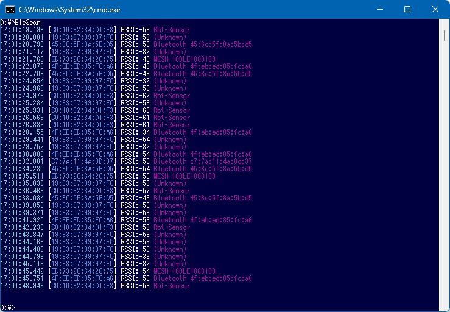
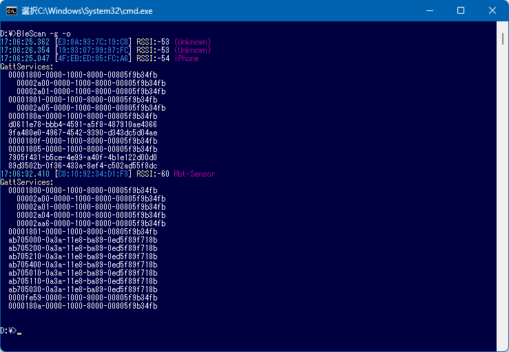
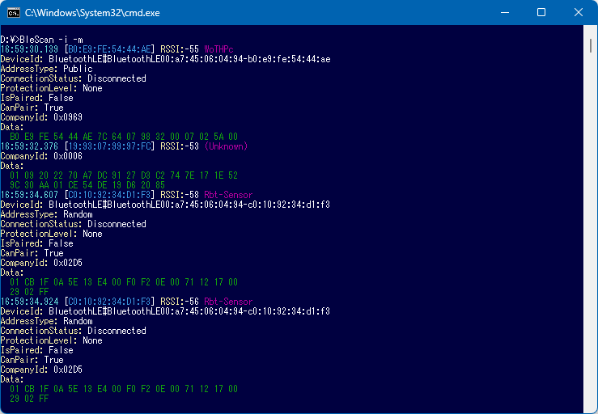

# Bluetooth tool

Bluetooth LE tool for Windows 10 version 2004 or later.

## Install

```
> dotnet tool install -g DeviceTool.Bluetooth
```

## Commands

| Command | Description |
|:-|:-|
| `scan` | Scan BLE advertisements |
| `gatt` | Show GATT services of a device |

### scan

```
bttool scan [options]
```

| Option | Description |
|:-|:-|
| `--active` / `-a` | Active scanning |
| `--once` / `-o` | Show each device only once |
| `--info` / `-i` | Show device information |
| `--gatt` / `-g` | Show GATT services |
| `--manufacturer` / `-m` | Show manufacturer data |
| `--section` / `-s` | Show data sections |
| `--duration` / `-d` | Scan duration in seconds (0: until Enter or Ctrl+C) |
| `--rssi` / `-r` | Minimum RSSI in dBm |
| `--name` / `-n` | Filter by name (partial match) |
| `--address` | Filter by address |
| `--company` / `-c` | Filter by company ID |

```
bttool scan
bttool scan -a -o
bttool scan -a -o -i
bttool scan -a -o -g
bttool scan -a -o -m
bttool scan -a -d 30 -r -70
bttool scan -a -m -c 0x0969
```

### gatt

```
bttool gatt -a <address> [options]
```

| Option | Description |
|:-|:-|
| `--address` / `-a` | Device address (required) |
| `--read` / `-r` | Read characteristic values |
| `--uncached` / `-u` | Do not use GATT cache |

```
bttool gatt -a AA:BB:CC:DD:EE:FF
bttool gatt -a AA:BB:CC:DD:EE:FF -r
```




