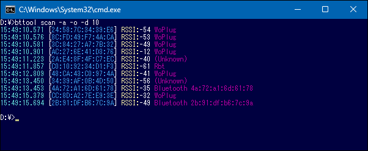
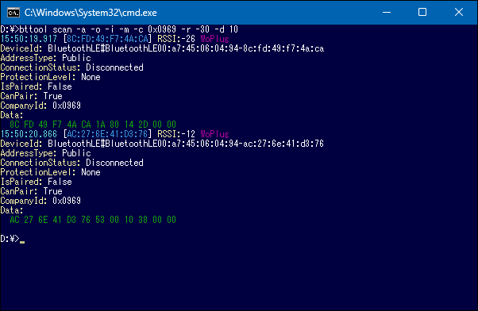
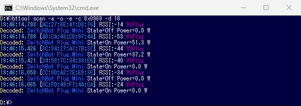
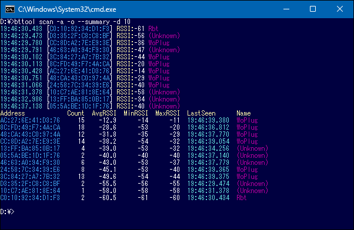
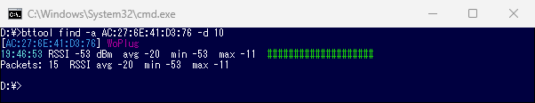
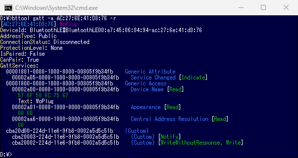
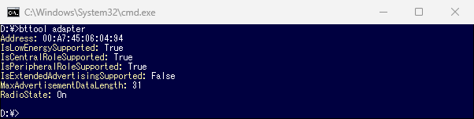
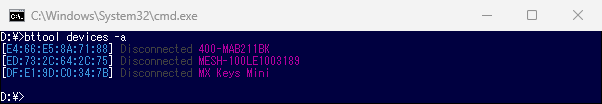
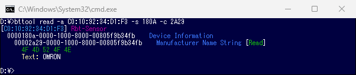
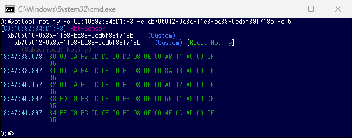

# Bluetooth tool

Bluetooth LE tool for Windows 10 version 2004 or later.

## Install

```
> dotnet tool install -g DeviceTool.Bluetooth
```

## Commands

| Command | Description |
|:-|:-|
| `scan` | Scan BLE advertisements |
| `find` | Track the signal strength of a device |
| `gatt` | Show GATT services of a device |
| `adapter` | Show Bluetooth adapter information |
| `devices` | List paired BLE devices |
| `read` | Read a characteristic value |
| `write` | Write a characteristic value |
| `notify` | Subscribe to characteristic notifications |

### scan

```
bttool scan [options]
```

| Option | Description |
|:-|:-|
| `--active` / `-a` | Active scanning |
| `--once` / `-o` | Show each device only once |
| `--info` / `-i` | Show device information |
| `--gatt` / `-g` | Show GATT services |
| `--manufacturer` / `-m` | Show manufacturer data |
| `--section` / `-s` | Show data sections |
| `--extra` / `-x` | Show extra advertisement information |
| `--duration` / `-d` | Scan duration in seconds (0: until Enter or Ctrl+C) |
| `--rssi` / `-r` | Minimum RSSI in dBm |
| `--name` / `-n` | Filter by name (partial match) |
| `--address` | Filter by address |
| `--company` / `-c` | Filter by company ID |
| `--service` / `-u` | Filter by service UUID |
| `--decode` / `-e` | Decode advertisement data with decoder definitions |
| `--decoders` | Decoder definition file (default: built-in) |
| `--format` / `-f` | Output format (`text` or `json`) |
| `--summary` | Show summary at the end |

```
bttool scan
bttool scan -a -o
bttool scan -a -o -i
bttool scan -a -o -g
bttool scan -a -o -m
bttool scan -a -o -x
bttool scan -a -d 30 -r -70
bttool scan -a -m -c 0x1234
bttool scan -a -u 180F
bttool scan -a -e
bttool scan -a --decoders my-decoders.json
bttool scan -a -o -f json
bttool scan -a -d 60 --summary
```






### find

```
bttool find -a <address> [options]
```

| Option | Description |
|:-|:-|
| `--address` / `-a` | Device address (required) |
| `--duration` / `-d` | Duration in seconds (0: until Enter or Ctrl+C) |

```
bttool find -a AA:BB:CC:DD:EE:FF
bttool find -a AA:BB:CC:DD:EE:FF -d 60
```



### gatt

```
bttool gatt -a <address> [options]
```

| Option | Description |
|:-|:-|
| `--address` / `-a` | Device address (required) |
| `--read` / `-r` | Read characteristic values |
| `--uncached` / `-u` | Do not use GATT cache |

```
bttool gatt -a AA:BB:CC:DD:EE:FF
bttool gatt -a AA:BB:CC:DD:EE:FF -r
```



### adapter

```
bttool adapter
```



### devices

```
bttool devices [options]
```

| Option | Description |
|:-|:-|
| `--all` / `-a` | Include disconnected devices |

```
bttool devices
bttool devices -a
```



### read

```
bttool read -a <address> -c <characteristic> [options]
```

| Option | Description |
|:-|:-|
| `--address` / `-a` | Device address (required) |
| `--service` / `-s` | Service UUID |
| `--characteristic` / `-c` | Characteristic UUID (required) |

```
bttool read -a AA:BB:CC:DD:EE:FF -c 2A19
bttool read -a AA:BB:CC:DD:EE:FF -s 180F -c 2A19
```



### write

```
bttool write -a <address> -c <characteristic> -v <value> [options]
```

| Option | Description |
|:-|:-|
| `--address` / `-a` | Device address (required) |
| `--service` / `-s` | Service UUID |
| `--characteristic` / `-c` | Characteristic UUID (required) |
| `--value` / `-v` | Value in hex (required) |
| `--no-response` / `-n` | Write without response |

```
bttool write -a AA:BB:CC:DD:EE:FF -c 2A06 -v 01
bttool write -a AA:BB:CC:DD:EE:FF -s 6E400001-B5A3-F393-E0A9-E50E24DCCA9E -c 6E400002-B5A3-F393-E0A9-E50E24DCCA9E -v 48656C6C6F -n
```

### notify

```
bttool notify -a <address> -c <characteristic> [options]
```

| Option | Description |
|:-|:-|
| `--address` / `-a` | Device address (required) |
| `--service` / `-s` | Service UUID |
| `--characteristic` / `-c` | Characteristic UUID (required) |
| `--duration` / `-d` | Duration in seconds (0: until Enter or Ctrl+C) |

```
bttool notify -a AA:BB:CC:DD:EE:FF -c 2A37
bttool notify -a AA:BB:CC:DD:EE:FF -c 2A19 -d 60
```



## Decoder definitions

`scan --decode` uses the built-in definitions ([DeviceTool.Bluetooth/Data/decoders.json](DeviceTool.Bluetooth/Data/decoders.json)). `--decoders` uses the definitions in the given file instead (implies `--decode`).

| Property | Description |
|:-|:-|
| `name` | Display name |
| `companyId` | Target: manufacturer data of the company ID |
| `serviceUuid` | Target: service data of the UUID |
| `prefix` | Target data starts with these bytes (hex) |
| `minLength` | Minimum length of the target data |
| `conditions` | Any one must match: `namePrefix`, or `serviceUuid` + `offset` + `mask` + `values` |
| `fields` | Values to decode (`name`, `type`, `minLength` and the properties below) |

| Field type | Properties |
|:-|:-|
| `integer` (default) | `offset`, `size` (1-4), `endian` (`little` / `big`), `signed`, `mask`, `shift`, `scale`, `digits`, `unit`, `invalid`, `map` |
| `composite` | `parts` (`offset`, `mask`, `shift`, `scale`), `sign` (`offset`, `mask`, `positive`), `digits`, `unit` |
| `uuid` | `offset` |
| `hex` / `text` | `offset`, `size` |

Numbers can be JSON numbers or `"0x"` hex strings.
